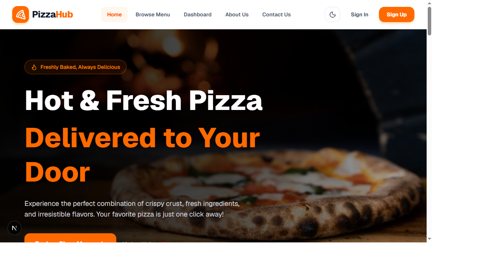
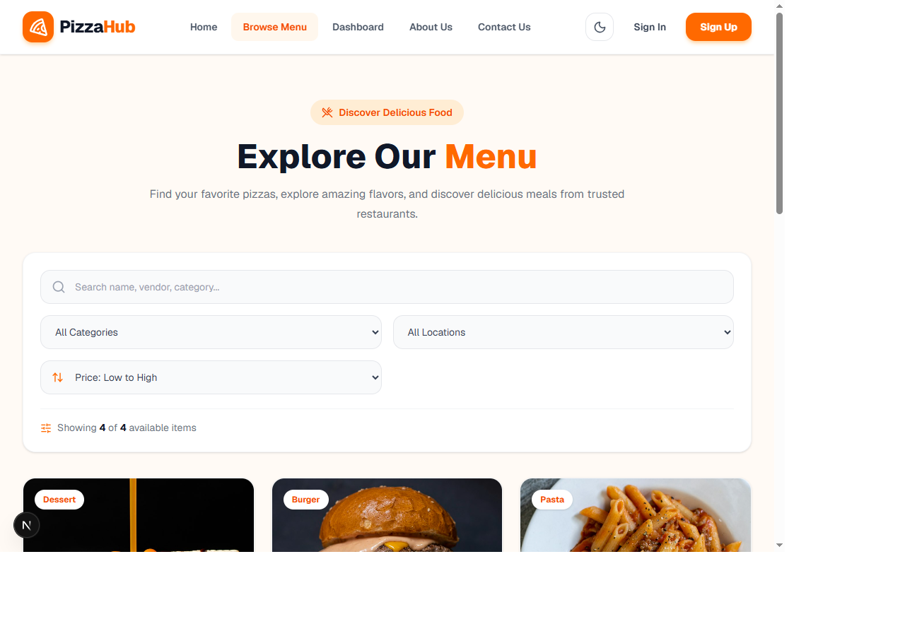

# PizzaHub — Pizza Ordering & Delivery Platform

PizzaHub is a full-stack, role-based pizza ordering platform. Customers discover
local pizzerias, browse approved menu items, and place delivery orders. Vendors
manage their restaurant, menu and incoming orders, and can buy a Premium
subscription through Stripe Checkout. Admins manage users, review menu items and
monitor subscription transactions.

- **Frontend:** Next.js App Router + ShadCN UI (this repository)
- **Backend:** Express + MongoDB (`../pizza-hub-server`)
- **Deployment:** Vercel frontend + Vercel serverless Express API

## Live links

| | URL |
| --- | --- |
| Frontend | <https://pizza-hub-rho-one.vercel.app> |
| API | <https://pizza-hub-server-zeta.vercel.app> |
| API health | <https://pizza-hub-server-zeta.vercel.app/health> |
| Client repo | <https://github.com/hridoyhossain0/pizza-hub> |
| Server repo | <https://github.com/hridoyhossain0/pizza-hub-server> |

## Demo accounts

| Role | Email | Password |
| --- | --- | --- |
| Administrator | `hridoyhossain00r@gmail.com` | `AAss1234` |
| Vendor (Free) | `vendor@pizzahub.dev` | `Demo@PizzaHub2026` |
| Vendor (Premium) | `premium@pizzahub.dev` | `Demo@PizzaHub2026` |
| Customer | `customer@pizzahub.dev` | `Demo@PizzaHub2026` |

These accounts are created by `npm run seed-demo` and share the same MongoDB
database in every environment. Administrator accounts cannot be created from the
public sign-up form.

## Features

### Public

- Landing page with hero, featured menu items (Premium vendors first), six pizza
  categories, benefits and "how it works" sections with reduced-motion-aware
  reveal animations.
- Browse Menu with advanced search (name, category, location and restaurant),
  category/location filters, price sorting (low → high, high → low), loading
  skeletons and an empty state.
- About and Contact pages; the contact form validates input and opens a
  pre-filled email draft.
- Dark / light mode toggle.

### Authentication & authorization

- Better Auth email + password and Google OAuth.
- Sign-up role choice (Customer or Vendor); admins are provisioned out-of-band.
- Password policy: 6+ characters with upper/lowercase letters.
- Blocked users are rejected on the server, not just hidden in the UI.
- Role-aware Navbar: avatar dropdown for signed-in users, Sign In / Sign Up for
  guests.
- Route guards for every dashboard, plus server-side role checks in every Server
  Action and API route.

### Customer

- Dashboard overview with order statistics.
- View item details; ordering requires a signed-in Customer.
- Track orders, view order details, cancel pending orders.
- Follow an order-status timeline with placement and restaurant-response times.
- Update name and profile image without being able to change role or plan.

### Vendor

- Restaurant profile management.
- Menu item CRUD with image upload, pending → approved/rejected review flow.
- Free plan limited to 3 active items; Premium unlocks unlimited items, a badge
  and featured placement.
- Accept/reject pending orders; only the owning vendor can act on an order.
- Stripe Checkout subscription page with success/cancel pages.

### Admin

- Platform statistics for users, vendors, customers, menu items, pending reviews
  and transactions, with role and subscription-payment charts.
- Vendor overview charts show order and menu review status totals.
- Search users, filter by role, block/unblock accounts.
- Review, approve, reject, search and delete menu items.
- Read-only transaction history (payment records cannot be edited).

## Tech stack

| Area | Packages |
| --- | --- |
| Frontend | `next` 16 (App Router, Server Actions), `react` 19, `typescript` |
| UI | `tailwindcss`, `shadcn`, `radix-ui`, `lucide-react`, `sonner`, `motion` |
| Charts | `recharts` |
| Auth | `better-auth` (email/password + Google), `mongodb` adapter |
| Data | `mongodb` driver |
| Payments | `stripe` (Express backend Checkout + webhooks) |
| Theming | `next-themes` |
| Tooling | `eslint`, `eslint-config-next`, `@tailwindcss/turbopack` |

Backend packages: `express`, `cors`, `mongodb`, `better-auth`, `stripe`,
`jsonwebtoken`, `dotenv`, `typescript`.

## Environment variables

Create `.env` in **each** project folder. Never commit `.env` files or copy
production secrets into the browser.

### `pizza-hub` (frontend)

```bash
NEXT_PUBLIC_API_URL=http://localhost:7000
MONGODB_URL=mongodb+srv://...
BETTER_AUTH_SECRET=<shared secret; use a long random value>
BETTER_AUTH_URL=http://localhost:3000
GOOGLE_CLIENT_ID=<Google OAuth client id>
GOOGLE_CLIENT_SECRET=<Google OAuth client secret>
```

### `pizza-hub-server` (backend)

```bash
MONGODB_URL=mongodb+srv://...
BETTER_AUTH_SECRET=<same value as the frontend>
BETTER_AUTH_URL=http://localhost:3000
APP_URL=http://localhost:3000
PORT=7000
PUBLIC_API_URL=http://localhost:7000
JWT_SECRET=<random string, at least 16 characters>
JWT_TTL_SECONDS=3600
GOOGLE_CLIENT_ID=<same Google OAuth client id>
GOOGLE_CLIENT_SECRET=<same Google OAuth client secret>
IMGBB_API_KEY=<ImgBB API key>
STRIPE_SECRET_KEY=sk_test_...
STRIPE_WEBHOOK_SECRET=whsec_...
STRIPE_CURRENCY=bdt
STRIPE_UNIT_AMOUNT=49900
```

`PORT`, `PUBLIC_API_URL`, `JWT_TTL_SECONDS`, `STRIPE_CURRENCY`, and
`STRIPE_UNIT_AMOUNT` have defaults. Set `PUBLIC_API_URL` to the public API origin
in production. Generate `JWT_SECRET` with
`node -e "console.log(require('crypto').randomBytes(48).toString('hex'))"`.

## Running locally

```bash
# terminal 1 — Express API (port 7000)
cd pizza-hub-server
npm install
npm run dev

# terminal 2 — Next.js app (port 3000)
cd pizza-hub
npm install
npm run dev
```

Open <http://localhost:3000>.

### Stripe webhook (Premium)

```bash
stripe listen --forward-to localhost:7000/api/payments/webhook
```

Copy the printed `whsec_...` value into `STRIPE_WEBHOOK_SECRET`, restart the API,
then upgrade a vendor using test card `4242 4242 4242 4242`. Premium is activated
**only** by the signature-verified webhook; the browser success redirect never
changes the plan.

## Challenge implementations

### Challenge 1 — advanced search and price sorting

Search is implemented twice from one shared query shape so the page and the API
always agree:

- **API:** `GET /api/menu?q=&category=&location=&sort=&page=&limit=`
  (`pizza-hub-server/menu.ts`). `q` is matched case-insensitively against item
  name, description, category, location and restaurant name using an escaped
  regular expression. `sort` accepts `price_asc`, `price_desc` or `newest`
  (Premium items are featured first as the tie-breaker), and the response
  includes pagination plus category/location facets.
- **Page:** `/menu` reads `q`, `category`, `location` and `sort` from the URL on
  the first render, then `src/components/Menu/BrowseMenu.tsx` keeps every filter
  in the query string. A short debounce updates the URL with `router.replace`,
  so a filtered view is shareable, survives reload and works with back/forward.
- Search covers name, category, location and restaurant name; category and
  location filters are exact; sorting supports newest, price low → high, price
  high → low and name A → Z.
- Loading skeletons, a live result count and a dedicated empty state with
  "Clear filters" cover the non-happy paths.

All six required categories are stored verbatim on `menuItems.category:
Classic Pizzas, Vegetarian Pizzas, Meat Lovers, Specialty / Gourmet Pizzas,
Sides & Appetizers, Beverages & Desserts`.

### Challenge 2 — JWT verification middleware (Express)

The Express API issues and verifies its own short-lived tokens while Better Auth
remains the source of truth for identity:

1. The browser signs in with Better Auth (HTTP-only session cookie).
2. `POST /api/auth/token` (`pizza-hub-server/tokens.ts`) reads that cookie with
   `auth.api.getSession`, rejects missing/blocked accounts, and signs an HS256
   JWT (`sub` = user id, plus name/email/role) with `JWT_SECRET`, issuer
   `pizza-hub-server`, audience `pizza-hub-client` and `JWT_TTL_SECONDS`.
3. The browser calls the same-origin `POST /api/token` route, which forwards the
   Better Auth cookie server-to-server (the cookie is `SameSite=Lax`, so it
   cannot be sent to the API origin directly). `src/lib/api-client.ts` caches the
   returned JWT in memory, sends it as `Authorization: Bearer <token>`, and
   retries once after a forced refresh if the API answers `401`.
4. `requireAuth` (`pizza-hub-server/jwt.ts`) verifies the signature, algorithm,
   expiry, issuer and audience, then re-reads the user from MongoDB. A deleted or
   blocked account is rejected and the **role always comes from the database**,
   so a stale or tampered token cannot keep old privileges.
5. `requireRole("customer")` / `requireRole("vendor")` gate routes:
   - `POST /api/orders` → any authenticated user, then Customer only
   - `GET /api/orders` → authenticated users (returns only their own orders)
   - `POST /api/payments/checkout` → Vendor only
6. Ownership is always re-checked in the handler/database query. Requests carry
   no client-supplied user id or role:
   - customers can only see their own orders and cannot order their own items;
   - a vendor's checkout session is created from the verified token, so one
     vendor can never pay for another;
   - admins cannot place customer orders.

Responses use `401` for missing/invalid/expired tokens and `403` for valid
tokens with the wrong role or a blocked account.

### Optional feature #2 — order status timeline

The customer order detail page shows when the order was placed and whether the
restaurant is still deciding, accepted it, rejected it, or it was cancelled.
The response time uses the existing `updatedAt` value written by the vendor
decision or customer cancellation action; the timeline does not invent delivery
events that the current order model does not record.

## API routes (Express)

| Method | Route | Access |
| --- | --- | --- |
| `GET` | `/api/menu` | public (advanced search + sort) |
| `GET` | `/health` | public |
| `POST` | `/api/auth/token` | Better Auth session cookie |
| `GET` | `/api/orders` | JWT (own orders) |
| `POST` | `/api/orders` | JWT + Customer role |
| `POST` | `/api/payments/checkout` | JWT + Vendor role |
| `POST` | `/api/payments/cancel` | JWT + Vendor role |
| `POST` | `/api/payments/webhook` | Stripe signature |
| `POST` | `/api/uploads` | Better Auth session |

## UX states and error handling

- `src/app/loading.tsx` — route-level loader; the dashboard has a matching
  skeleton in `src/app/dashboard/loading.tsx`.
- `src/app/error.tsx` — client error boundary with retry and a digest reference.
- `src/app/not-found.tsx` — custom 404 page.
- Sonner toasts (`<Toaster />` in the root layout) report success and failure for
  sign-in/sign-up, menu and profile forms, vendor/admin actions, image upload,
  order placement, cancellations and Stripe checkout. Inline form messages are
  kept for accessibility; no `alert()` calls are used.

## Dashboard analytics

The admin overview includes role distribution and Premium payment-status charts.
The vendor overview includes order-status and menu-review charts. Both use
Recharts with values derived from the existing server-side dashboard queries.
The chart data is also available to assistive technology as text.

## Screenshots





Dashboard and order screenshots should only be added from test accounts with
sample data; never include personal information or provider secrets.

## Deployment checklist

1. Create a MongoDB Atlas database; permit connections from the selected API and
   Vercel deployments, then use the same `MONGODB_URL` for both services.
2. Deploy this Next.js app to Vercel. Set its environment variables from the
   frontend list above, with `NEXT_PUBLIC_API_URL` set to the deployed Express
   origin and `BETTER_AUTH_URL` set to the deployed frontend origin.
3. Deploy `pizza-hub-server` to Vercel as serverless functions. The Express app
   is exported from `api/[...route].ts` (via `app.ts`) and `vercel.json` rewrites
   every `/api/*` path to it; `local-server.ts` is used only for local
   development. Set `APP_URL` and `BETTER_AUTH_URL` to the Vercel frontend
   origin, and `PUBLIC_API_URL` to the API origin.
4. In Google Cloud OAuth, add the production Better Auth callback URL
   `https://pizza-hub-rho-one.vercel.app/api/auth/callback/google` as an
   authorized redirect URI, and allow the deployed frontend origin.
5. In Stripe, register
   `https://pizza-hub-server-zeta.vercel.app/api/payments/webhook` for the
   checkout and subscription events handled by the API, then set the issued
   signing secret as `STRIPE_WEBHOOK_SECRET`.
6. Confirm `/health` responds, sign in with Google and email, reload public and
   dashboard routes, verify browser CORS, and complete a Stripe test-mode
   upgrade before enabling live keys.

Never put server-only secrets in `NEXT_PUBLIC_*` variables.

## Scripts

```bash
npm run dev            # start the Next.js dev server
npm run build          # production build
npm run start          # serve the production build
npm run lint           # ESLint
npm run seed-demo      # create demo accounts, restaurants, menu and orders
npm run migrate-schema # migrate legacy field names to the assignment schema
npm run set-role -- user@example.com vendor   # change a role directly
npm run set-admin -- user@example.com Password123  # provision an administrator
```

## Notes

- Menu and profile images are uploaded through the Express API to ImgBB. Only
  the hosted ImgBB URL is stored in MongoDB. Set `IMGBB_API_KEY` on the API
  server and keep it out of the frontend.
- Customer orders are paid on delivery; Stripe is used only for vendor Premium
  subscriptions, as required by the assignment.
